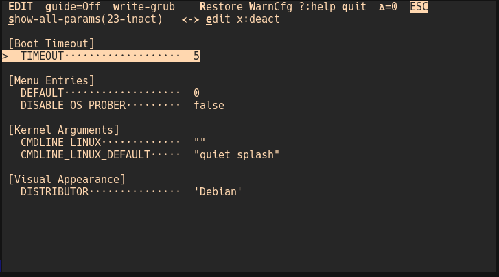

## GrubWiz: Safe GRUB Configuration Made Simple

`grub-wiz` is a terminal editor for `/etc/default/grub`. It replaces risky hand-editing with guided choices, live validation, and a review step before anything is written.

[](https://github.com/joedefen/grub-wiz/blob/main/demo/dwipe-2026-02-05.07-58.gif)

### Install and run

```sh
pipx install grub-wiz
grub-wiz        # re-runs itself with sudo as needed
```

Run `grub-wiz --help` for command-line options, or press `?` inside the app for every key.

---

## Quick start: the flow

Grub-wiz is built around a simple loop: **edit → review → write**, with backups there when you need them.

### 1. EDIT — change values

The first screen lists your active GRUB parameters, grouped by topic.

- Arrow keys move; `e` edits the selected value and `E` edits it in expert mode (i.e., reduced validation).
- `←`/`→` cycles preset values when a parameter offers them.
- `s` also shows inactive/commented parameters; `x` deactivates one (deferring to the `grub` default).
- `g` cycles guidance (off / enums / full) to explain a setting.
- Edits stay in memory until written; `q` or Ctrl-C asks before discarding.

### 2. REVIEW — check before writing

Press `w` to reach REVIEW from EDIT. It shows only what you changed or what has warnings.

- Each warning explains the problem; fix the value or press `x` to inhibit the warning (remembered in future sessions).
- `u` undoes a change; `e` edits again.
- Press `w` again to commit. An inline `Commit changes and update GRUB?` prompt appears: `y` writes the file atomically and runs `update-grub`, `ESC` cancels.

If a kernel or driver argument changed in a way that needs an initramfs rebuild, grub-wiz checks free space and offers to rebuild using your distro's own tool. A failed `update-grub` rolls the file back.

### 3. RESTORE — go back in time

Press `R` from EDIT to manage backups.

- Backups are timestamped and kept in `~/.config/grub-wiz` (newest 24).
- `r` restores, `d` deletes, `t` renames a tag, `v` views, `c` compares against a baseline (`b` sets it).
- Restoring only replaces `/etc/default/grub`; the boot menu is regenerated when you next write from EDIT.

### 4. WARNINGS-CONFIG — global warning choices

Press `W` to see every warning and inhibit/allow it up front. Most people simply dismiss unwanted warnings when they actually prove to be annoying on REVIEW.

---

## Safety notes

- Startup takes a `BASELINE` backup when the backup folder is empty; later backups are created only when grub-wiz writes a change.
- Backups are pruned to 24, always keeping the oldest; `-k` / `--keep-all-bak` skips pruning for one run.
- Restore refuses symlinks, NUL bytes, and shell command substitution, so a crafted backup cannot run as root.
- Unknown parameters are preserved. Parameters that use shell variable expansion (`$VAR`, `${VAR}`) are passed through untouched and hidden from the UI.
- `--factory-reset` clears the discovery cache, warning database, and remembered theme, but keeps backups.

Some distributions override `/etc/default/grub` through their own mechanisms — Fedora's `grubenv`, for example, can keep the menu hidden. If a change seems ignored, check the distro's tools first.

---

## Where things live

- `~/.config/grub-wiz/*.bak` — backups
- `~/.config/grub-wiz/warn-db.yaml` — inhibited warnings
- `~/.config/grub-wiz/ui-prefs.yaml` — remembered theme
- `~/.config/grub-wiz/custom_config.yaml` — optional custom parameter definitions
- `/var/lib/grub-wiz/` — machine-wide discovery cache and rollback copy

All of these are safe to delete except `custom_config.yaml` (unless not wanted now).

---

## Advanced

- **Grub parameter discovery**: grub-wiz asks `info grub` which parameters your system supports and hides the rest. Install `grub-doc` (Debian/Ubuntu) or `grub2-common` (Fedora/RHEL) for best results; `--discovery=disable` turns filtering off.
- **Roll-your-own-wizard-rules**: copy `~/.config/grub-wiz/canned_config.yaml` to `custom_config.yaml`, edit it, and restart. `--validate-custom-config` tests it.
- **Running `grub-wiz` within recovery mode**: remount root read-write (`mount -o remount,rw /`), then run grub-wiz by its full path.
- **Theme and symbols**: `T` opens the theme picker and `t` cycles palettes (including `mono`); `?` shows the font check. Use `--ascii` if symbol appear as boxes (or install the needed fonts).

For the kernel command-line arguments themselves, see the official Linux kernel documentation (`kernel-parameters.rst` / `kernel-command-line(7)`). They are not specific to grub-wiz.